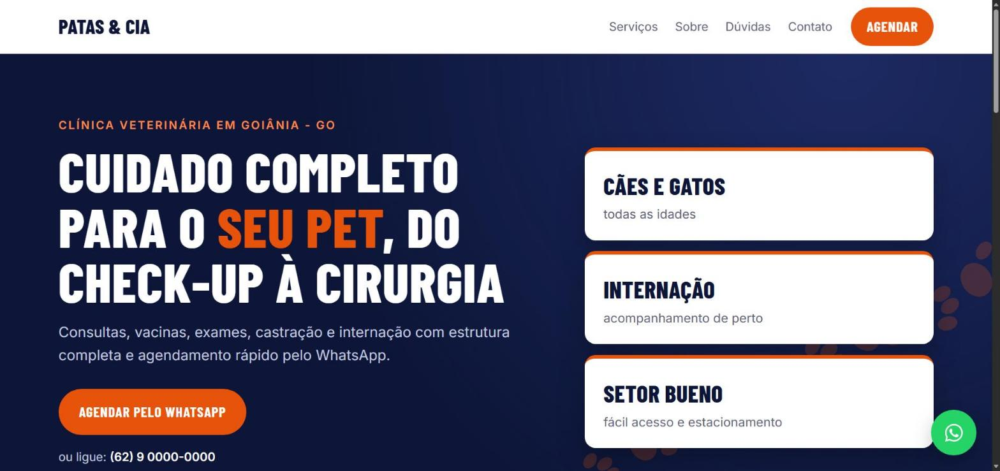
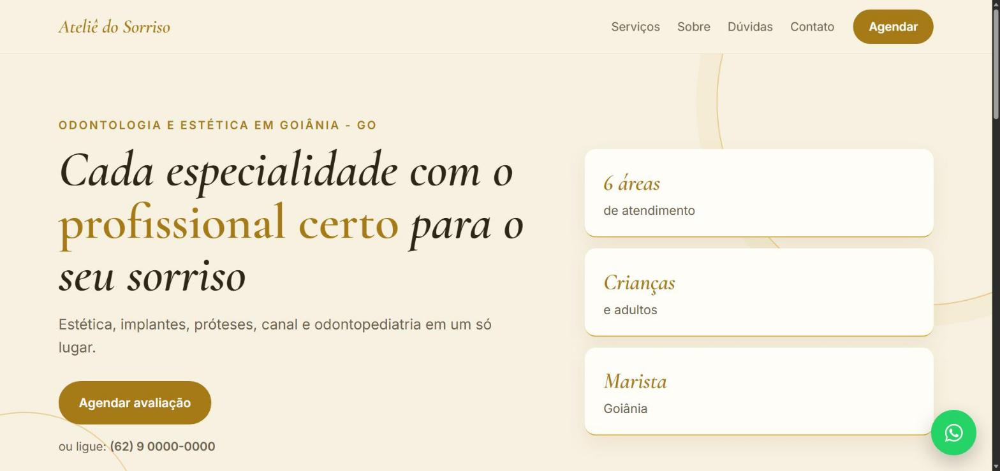
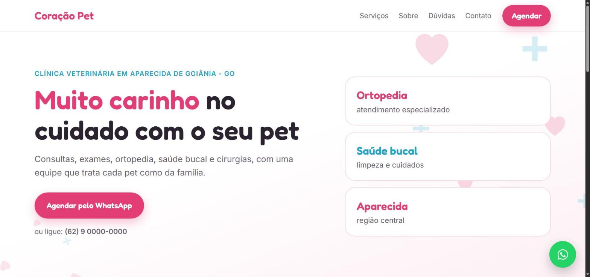
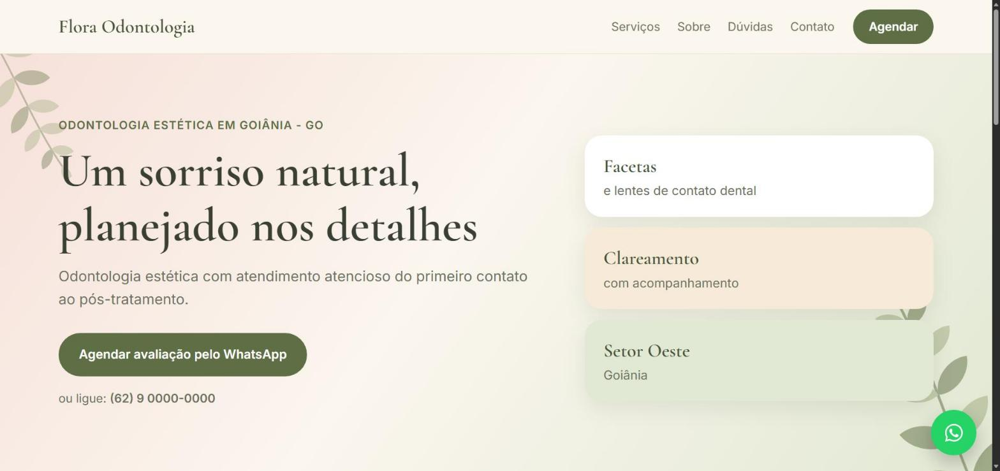

# Portfólio de Arthur · Sites e landing pages

Sites rápidos, com a identidade de cada negócio, pensados para o celular e para levar o cliente direto para o WhatsApp.

**Veja o portfólio no ar:** https://arthursites.netlify.app



## Projetos

Cinco sites completos para clínicas odontológicas e veterinárias. São projetos demonstrativos com marcas fictícias, criados a partir de negócios reais do setor.

| Projeto | Segmento | Estilo | Ver no ar |
|---|---|---|---|
| Patas & Cia | Clínica veterinária | Azul-marinho e laranja, títulos condensados, rastro de patinhas | [abrir](https://arthursites.netlify.app/projetos/patas-e-cia/) |
| Ateliê do Sorriso | Odontologia e estética | Creme e dourado, serifa em itálico | [abrir](https://arthursites.netlify.app/projetos/atelie-do-sorriso/) |
| Coração Pet | Clínica veterinária | Rosa e azul, letra arredondada | [abrir](https://arthursites.netlify.app/projetos/coracao-pet/) |
| Flora Odontologia | Odontologia estética | Tons pastéis e verde musgo, folhas ao fundo | [abrir](https://arthursites.netlify.app/projetos/flora-odontologia/) |
| Dra. Clara Mendes | Consultório odontológico | Azul-marinho, letra fina em caixa alta, monograma | [abrir](https://arthursites.netlify.app/projetos/clara-mendes/) |

<p>
  
  
  
  
</p>

## O que todo site entrega

- Layout pensado primeiro para o celular
- Botão de WhatsApp com a mensagem de agendamento já escrita
- Serviços, horários, endereço e perguntas frequentes
- Identidade visual da marca: cores, tipografia e decoração próprias
- Carregamento rápido, sem frameworks pesados

## Como os sites são construídos

Todos os projetos partem do mesmo modelo, e cada negócio ganha dois arquivos próprios:

```
projetos/patas-e-cia/
├── index.html   estrutura comum a todos os sites
├── styles.css   estilo base, responsivo
├── script.js    monta a página a partir do config.js
├── config.js    conteúdo do negócio: nome, serviços, contatos, textos
└── tema.css     identidade visual: cores, fontes e decoração
```

Assim, um site novo fica pronto em pouco tempo e cada cliente continua com um visual único. Tecnologias: HTML, CSS e JavaScript puro, sem dependências.

## Contato

Quer um site para o seu negócio? Fale comigo no Instagram: [@arthurlopesjardim](https://www.instagram.com/arthurlopesjardim/).
